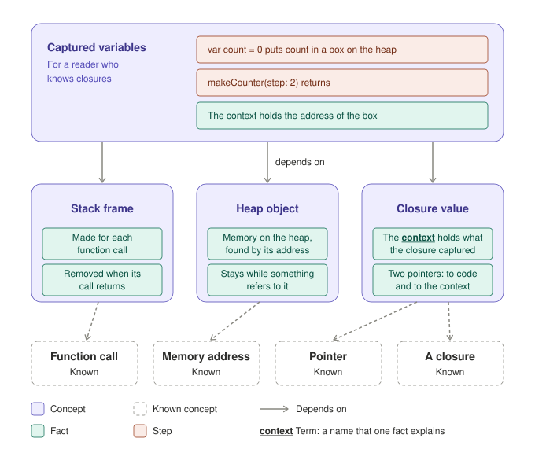
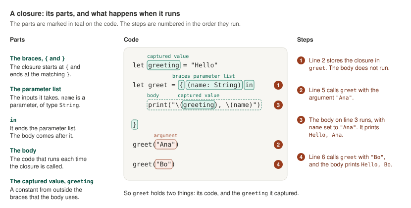

# Stoicheia Teaching Philosophy

This document states how we think about teaching in Stoicheia: what we want for the reader, who the reader is, what our words mean, and what we believe makes an explanation work. It is a statement of philosophy, not a set of rules. It was approved on 2026-10-19. On the same day, the user removed the size check, changed atomizing to mean splitting a concept into its parts, and approved the new text. Later that day, the user asked that a known concept stay on the dependency graph, as a grey dashed box, and chose that each concept is taught in views: first what it is, then how it works on its code, and then how it works in memory. The user approved both changes on 2026-10-19. The rules in CLAUDE.md are written from it.

Stoicheia makes an explanation of a concept at the moment the reader is studying it. The reader names the concept. Stoicheia finds the parts the concept is made of and the concepts it depends on. Then it teaches the concept in up to three views: what it is, how it works on its code, and how it works in memory. Each concept that the reader does not know is taught right before the first view that needs it.

The philosophy started with a guide that teaches how to read a timeline chart. After one reading, one of us went from not being able to read a timeline chart to understanding every part of one. We then worked the philosophy out in Cortex, on its Closures idea, one page at a time. Most of the beliefs below come from a moment when a Closures page did not teach, and each one says which moment. The words in "Words we use" were added for Stoicheia.

## In brief

We take a concept that seems, or is, complex and find the parts it is made of. We keep splitting until each part cannot be split any further, because a part of that size is understood as soon as it is read. We explain each part in a few connected sentences, so the reader sees how the parts fit together. Each concept starts by answering four questions: what it is, what problem it solves, how it works, and when you use it. Then it shows how it works on its code, and then in memory, one level at a time. What a thing is and what happens when it runs are taught apart: the parts are labeled on the code, and the steps walk through the same code as it runs. When a concept uses other concepts that the reader does not know, we teach each of them right before the view that needs it, and then use it by its name. We show what we explain, and we explain every part of what we show. We write plain, literal sentences, and every new term has its explanation right where it appears. We say only what is true of the real program. At the end, the reader tests what they now understand.

## What we want for the reader

We want the reader to go from confusion about a concept to understanding it fully, without ever having to figure anything out on their own.

Understanding, for us, means that the reader can read every part of the code or the drawing in front of them, and explain what it does and why. "Intuitive" means that each part is understood as it is read: the reader never stops to work out something that the page left out.

From the discussion of the timeline-chart guide: "It removed the having to figure it out."

We want this for any concept the reader meets while studying, at the moment they meet it. The reader should not have to wait until someone has written a page about it. A concept whose parts the reader could not tell apart is split into the parts and the concepts it is made of, which the reader learns in order.

When Stoicheia was planned: "providing an ad hoc, detailed explanation to me as I'm studying", and "now I'm actually able to easily move from step to step to step to put all these ideas together".

We also want to show what really happens when code runs. In Swift, three lines make a closure, and nothing in them says where the closure's code is kept or where the values it uses are. Code like that can seem to work for no reason the reader can see. We show the reason: what the compiler makes from the code, and what is in memory while the program runs. Afterwards, the reader can explain what their code does, not only write it.

## Who we teach

We teach a Swift developer. They write Swift every day, and they know what a pointer and a memory address are. The concept in front of them is new to them, or they use it without knowing how it works. They have never read the compiler's output or the source of the Swift runtime. They want to understand what their own code does when it runs.

Stoicheia teaches concepts from Swift, iOS and Apple's other platforms, and algorithms. Every concept is explained in Swift, because Swift is the reader's own language. An algorithm, for example, is written in Swift, and its example runs as a Swift program.

When Stoicheia was planned: "everything will always be spoken of in terms of Swift because that's my native language."

We do not explain what they already know. We explain everything else.

## Words we use

Each of these words has one meaning, in this document and in Stoicheia. Each one also has one shape in the drawings.

When these words were defined: "we need to have a codified language attached to a visual of what this looks like."

- **Part.** One piece that a concept is made of. Example: the parameter list `(name: String)` of a closure. Facts explain a part. A part that is made of its own parts is a concept.
- **Fact.** A statement of what something is. Nothing happens in it, and it is true at every moment. Example: "`String` is the type of the parameter `name`."
- **Step.** A statement of one thing that happens at one moment while the program runs. Example: "Line 5 calls `greet` with the argument `"Ana"`."
- **Term.** A name that one fact explains. Example: "body", which the fact "The body is the code that runs each time the closure is called" explains.
- **Concept.** A name that takes several facts or steps to explain, such as "function", "closure", "capture", "stack frame", or "binary search". Once the reader knows it, later facts and steps use it by its name. The reader names a concept to study it.
- **Known concept.** A concept that the reader already knows. It is not taught. An explanation shows nothing about it, and its name can still appear as a plain word in the sentences that use it. The dependency graph still shows it, as a grey dashed box with no number.
- **Depends on.** A fact or a step depends on each fact, term, and concept that it uses. A view depends on each concept that its own facts and steps use, so two views of one concept can depend on different concepts. A concept depends on everything that its views depend on. The reader must know everything that a fact, a step, or a view depends on before they read it.
- **Dependency graph.** A concept, the concepts it depends on, the concepts those depend on, and so on, with one arrow for each "depends on". It is drawn in one section for each level, with the code at the top and memory below it. A concept with views at two levels has a box in each section, because its views at each level depend on different concepts.
- **Teaching order.** An order of parts, steps, and views in which each one comes after everything it depends on. In software terms, it is a topological order of the dependency graph.
- **Level.** How deep an explanation goes: what the code does, what is in memory while it runs, or what the compiler makes. Each view is at one level.
- **Format.** One way a study lays out what it teaches. Each format has a name and a kind of concept it is used for. A study can use more than one format.
- **View.** One page of a concept. A concept has up to three views, in this order. **What it is** answers four questions: what it is, what problem it solves, how it works, and when you use it and when you don't. **Parts and Steps** shows how it works on its code, in the Parts and Steps format. **In memory** shows how it works in memory, in the Steps in Memory format. A concept has only the views it needs: a stack frame is already about memory, so it has What it is and In memory.
- **Parts and Steps.** The format for a piece of code. The parts are on the left, explained in connected sentences and marked by name on the code. One copy of the code is in the middle. The steps are on the right, in the order the program runs them.
- **Steps in Memory.** The format for what is in memory while code runs. One copy of the code is on the left, and a drawing of the stack and the heap is beside it. Each step marks the line that runs, and the drawing changes to match.

The drawing below is the dependency graph of the In memory view of Captured Variables, from Cortex, for a reader who knows closures. Concepts are purple boxes, facts are teal, steps are orange, known concepts are grey dashed boxes, a term is underlined, and each arrow is one "depends on". The drawing in "A concept is made of parts" shows parts: each part is marked in teal on the code, with its name.



## What we believe

### A concept is made of parts

A concept that seems complex is made of parts that are each simple. We find those parts, and we keep splitting each one until it cannot be split any further. That is where the splitting stops. There is no count to reach and no limit to stay under: the concept itself shows where its parts end. We call this atomizing.

For example, a function runs a block of code, and it can take arguments. An argument is a value passed in a call, and its type must be the type of the parameter that receives it. There is nothing simpler to explain about an argument, so for a function, the argument is where the splitting stops.

Atomizing splits the concept, not the sentences that explain it. Each part is explained in a few connected sentences, and the parts are shown together, so the reader sees how they fit. A page that puts each sentence in its own box, with its own label and number, makes the reader put the sentences back together, and that is the work Stoicheia is there to remove.

A statement that uses a name the reader does not know depends on that name. If one fact explains the name, the name is a term, and that fact comes first. If the name needs several facts, it is a concept, and it is taught first.

More detail, for us, means more parts of the same small size, never longer or harder ones. A part can be hard to read only because of what it depends on. Once the reader knows those, it is simple.

From the discussion of the timeline-chart guide: "There's one tiny component, and that component is so small that there's nothing complex to understand." And when the closure introduction was planned: "When I say detail, I mean simplicity." When the words of Stoicheia were defined: "There's a certain point where it's like, 'This is just a fact.' There's nothing that's operating, nothing is doing anything. It just is." When the closure introduction had been split into seventeen separate statements: "we don't want to isolate each fact so much that the brain has a hard time actually even piecing the facts together". And: "When we get to a point where it's at its irreducible point, I think that's a better way to put it. Then that's a teachable thing that can easily be picked up."

In Cortex, the introduction to closures teaches what a closure is in eleven statements. A first version of this philosophy split them into seventeen statements, each one on its own, with a label and a number. That made a concept the reader already knew hard to follow. Split by its parts instead, a closure is taught from this example:

```swift
let greeting = "Hello"
let greet = { (name: String) in
    print("\(greeting), \(name)")
}
greet("Ana")
greet("Bo")
```

The closure in this example is a closure expression: a function with no name, written between braces. It can be stored in a constant and called later. Its parts:

- **The braces, `{` and `}`.** The closure starts at `{` and ends at the matching `}`.
- **The parameter list, `(name: String)`.** The inputs that the closure takes. `name` is a parameter, and `String` is its type.
- **`in`.** It ends the parameter list. The body comes after it.
- **The body, `print("\(greeting), \(name)")`.** The code that runs each time the closure is called.
- **The captured value, `greeting`.** A constant declared outside the braces that the body uses. The closure captures it: it keeps `greeting`, so that the body can use it each time it runs. Capture is a concept inside the closure, with its own parts.

What happens when the code runs:

1. Line 2 stores the closure in `greet`. The body does not run.
2. Line 5 calls `greet` with the argument `"Ana"`.
3. The body runs, with `name` set to `"Ana"`. It prints `Hello, Ana`.
4. Line 6 calls `greet` with the argument `"Bo"`, and the body prints `Hello, Bo`.

So `greet` holds two things: its code, and the `greeting` that it captured.



### What a thing is, and what happens when it runs, are taught apart

A fact is true without anything happening. A step is one thing that happens while the program runs. So the parts of a concept, and the facts that explain them, are not mixed with its steps. The parts are labeled on the code, each with its name. The steps walk through the same code as it runs: the line that runs is marked, and the values it changes and what it prints appear beside it. When a concept has code, the parts and the steps are visible at the same time: the parts on the left, the steps on the right, and one copy of the code between them.

When the facts and the steps of the closure were in one list: "facts are things that can exist without steps", and "I actually think the steps should be communicated when we're actually looking at code." And: "If we're dealing with something in the code where we are able to talk about all the different parts, then on the right side we can actually step through as it progresses as the code executes."

### Each part and step needs only what comes before it

A reader can understand a part or a step only when they already know everything it uses. So each one uses only the parts, terms, and concepts before it, and no word, symbol, or line of code appears before it has been explained. This order is the teaching order. The reader is never left to work out something that the page skipped.

When the closure introduction was planned: "There is this one point, and then they go to the next point, and each point is extremely clear on its own."

### A concept can need other concepts first

A concept that the reader has learned can be used as one thing, by its name, such as "stack frame". When a concept uses another concept that the reader does not know, we teach that concept first, and then use it by its name. It is taught at the point where it is needed, which can be in the middle of the concept that uses it, after the parts it needs. A concept that only one view uses is taught right before that view. A concept can be made of smaller concepts. We never add a concept that the explanation does not need, because it only adds work before the concept itself.

A closure is a function, so a closure depends on the concept of a function: it runs a block of code, and it can take arguments. A reader who does not know what a function is learns that first. A reader who knows functions starts at the closure.

When chunking was added to this philosophy: "Depending on what the thing is, it may require an understanding of 2 or more chunks." The same message said not to treat every concept as if it needed several chunks. When Stoicheia was planned: "We don't want this to automatically create a lot of complexity where there isn't any."

In Cortex, Captured Variables asks how `count` still exists after `makeCounter(step:)` has returned. The answer uses three separate concepts: a stack frame, which is removed when its call returns; a heap object, which stays as long as something refers to it; and a closure value, which is two pointers, one to code and one to the context. Once those three are learned, the answer is two steps and one fact: `var count = 0` puts `count` in a box on the heap, `makeCounter(step: 2)` returns, and the context holds the address of the box. The drawing in "Words we use" shows this.

Only the In memory view of Captured Variables uses those three concepts. What a captured variable is, and what its code does, use only a closure. So the reader learns what a captured variable is, and watches its code run, before a stack frame or a heap object appears. The three concepts are taught after that, right before the In memory view.

When Captured Variables taught stack frames and heap objects before it said what a captured variable is: "the stack and the heap are relevant, but I feel like they need to be a little bit further down."

The closure has one concept inside it, capture. Capture uses the braces and the body, so it comes after them, not before the whole closure. So capture is the last part of a closure.

### What the reader already knows is not taught again

A known concept is not taught again. This follows from who we teach: we do not explain what the reader already knows. So the same concept takes more teaching for one reader than for another.

Stoicheia learns which concepts the reader knows from three sources, in this order. First, what "Who we teach" says every reader knows: the Swift code they write every day, pointers, and memory addresses. Second, the concepts that earlier studies taught, as "Each fact is explained in one place" says. Third, the reader: Stoicheia lists every other concept in the dependency graph, each with its name and its first fact, such as "Stack frame: the memory made for each function call", and the reader marks the ones they know. During a study, the reader can also mark any part with "I know this". Stoicheia decides what to teach only after that, because the answers change it.

We do not test the reader to find out what they know. A test of what the reader remembers is recall practice, which belongs to the reader's review system, not to Stoicheia, and the reader is the one person who knows what they know. The problems at the end of a study test what that study taught, not what the reader knew before it.

When the reader marks something as known, it leaves every explanation entirely: its facts, its name, and its mark on the code. Nothing is left in its place, not even a note that it is known, because anything on the page is something the reader has to read. The list of what the reader knows is kept outside every study. A reader who finds they do not know something well removes it from that list, and the study teaches it again.

The dependency graph is different. An explanation says what a concept and its parts are. The graph says which concepts depend on which. Seeing that Captured Variables depends on a stack frame, even one the reader knows, helps the reader see how Captured Variables works. So a known concept stays on the graph, as a grey dashed box with no number. It is not in the teaching order, and the reader can still click it to open its page.

When the open questions were decided: "use the three sources: what Who we teach says, earlier studies, and asking the reader, with no testing." When a part marked as known still showed its name: "When I mark something as 'I know this,' it needs to completely vanish." And: "that's cluttering up my visual space. That's something my brain has to process." When known concepts were taken off the graph too: "Knowing that those concepts are connected is still important." And: the graph "is explaining the relationship between ideas", while the code "is actually explaining the information".

For a reader who knows closures, Captured Variables starts at its own first view, and its graph shows A closure as a grey dashed box below it. Its In memory view needs stack frame, heap object, and closure value, so those three are taught right before that view. For a reader who does not know closures, Captured Variables first teaches a closure, with capture as its last part.

### The example needs no effort

An example is there to show the concept. If the reader must learn the example first, they are learning two things at once, and the concept gets harder. So the example is small and plain: a few lines, everyday names, whole numbers, and real values instead of placeholders. No name in it sounds like a term or a concept being taught, so the reader never wonders whether the name is part of the concept. We keep one example through every level of a concept, so the reader learns its code once.

In Closures, the example is `greet`, which prints "Hello, Ana" and then "Hello, Bo". In the stack-and-heap lesson, a class named `Point` became `Player`, because "Point" reads like "pointer".

### Each concept answers four questions

A reader who opens a concept first wants to know what it is. A page that starts anywhere else, such as a question about code the reader has not seen, leaves out the one thing they came for. So every concept starts with its view What it is, which answers four questions, in this order:

1. What is it?
2. What problem does it solve?
3. How does it work?
4. When do you use it, and when don't you?

The first sentences of a concept say what it is, in words the reader already knows, and they name no code from another page. The example comes right after them. The answer to what problem it solves comes from the concept itself, not from the concept that uses it, so it also works for the concept the reader named, which has nothing above it.

The answer to how it works is short on the first page: one or two sentences. Parts and Steps then shows those same sentences happening on the code, and In memory shows them in memory. So the reader meets how it works at each level, in more detail each time, and each fact is still explained in one place.

A question that does not fit a concept is left out, instead of being given a forced answer. A reader never chooses to make a stack frame, so its page does not ask when you use one. The answer to when you don't use something can need something new, such as a capture list for captured variables. A new thing there is either one term, explained in the same sentence, or a link to its own concept, so the question never adds a concept that the study does not need.

When Captured Variables started from a question about `count` and `makeCounter(step:)`: "You have to think about this from the perspective of the person when you click on one of these, like 'heap object.' 'Well, what even is a heap object?'" When the four questions were chosen: "for the 'what is it' page, I wonder if it would be good to gear it toward answering these questions". And: "then for the parts and steps, really gear it toward the third question which is, HOW does it work".

### A question gives every part a reason

A reader follows an explanation more easily when they know what it is for. So each view starts from a question, and every part and step in it is there to help answer it. The four questions above start What it is. A question that the example raises starts the view that answers it.

In Closures: "`greet` is a constant, but `greet("Ana")` runs code and prints `Hello, Ana`. What does `greet` hold?" In Captured Variables, the steps show that `counter()` still adds to `count` after `makeCounter(step:)` has returned, and In memory starts from the question of where `count` is kept.

### Everything connects to the reader's own code

The reader came to Stoicheia to understand their own code. So we start from code they could have written, and we show where the concept appears in the code they write every day.

In Closures: "Every `Task { }`, `.task { }`, and `Button("Save") { }` passes a closure. The code between the braces runs when that closure is called, not where it is written."

### The whole first, then each part in its place

A part is easier to understand when the reader has already seen where it is in the whole. So we show the whole once, then each part with the whole still visible around it, then all the parts working together, in the order they happen. Before the reader reads a drawing, they learn how to read it.

For a concept, the whole is its first view, What it is, which answers all four questions, with how it works in short. Parts and Steps and In memory then show how it works, one level at a time.

When the parts of a drawing were shown on their own: "I actually don't know what part, or where, that piece is from."

### Show it instead of describing it

A picture of a thing is clearer than a description of it. So we draw what can be drawn: what a line of code makes, which code calls which, and what is in memory. When we explain a part of a picture, we show that part, instead of describing it in words. Nothing in a picture is left unexplained, because a name alone does not tell the reader what a thing is or what it holds. Drawings of memory follow the same conventions on every page, so the reader learns to read them once.

When a rule described the grey line under a card's name only in words: "I'm not sure what the gray line is." When a card showed only the name `greeting`: "having just `greeting` by itself is kind of like, 'Well, what is that?'"

### The reader never has to imagine

Everything an explanation talks about is in front of the reader: the line of code that runs, the call that starts the program, and memory that is gone, when it explains where something was. The reader never has to keep in mind something that they cannot see.

When a page described a call that its drawing did not show: "That makes it so I have to imagine some piece of code was executed, and that's not good."

This holds for every piece of code a sentence names. When a sentence names a function, a type, a constant, or any other code, such as `makeCounter(step:)`, that code is on the same page, in the code it belongs to, near the sentence. The name in the sentence is marked, and pointing at it marks the same code, so the reader can go from the name to the code and see where it is. A sentence that names code from another example shows that example beside the sentence. This is a rule that can be counted: every name written as code in a sentence must match code shown on the same page.

When a lesson about stack frames named `makeCounter(step:)` without showing it: "any mention or reference to code has to be visible where it is, where it's being talked about", and "there's nowhere my eyes can go to then see what `makeCounter(step:)` is, or where it is in its context."

### The reader never loses their place

An explanation appears where the question comes up. When a new term appears, the fact that explains it opens right there, without leaving the sentence. Each part's name is on the code it names, and each step marks the line that runs. The reader never has to go somewhere else for an answer and then find where they were.

From the request for this document: "There's no new terminology that comes up that the user can't quickly find out what that is." And when a word's meaning was in a list at the bottom of the page: "Now they have to go back to where they were to find out what it was that they were reading."

### Plain, literal words

We write for someone who is new to the concept, not for an expert. Sentences are short, and each says one thing. We never explain with analogies or metaphors, because they make an explanation harder to understand, not easier. We say what the thing is, what it does, and why, and we make it simpler with concrete examples and by teaching one part at a time, in order. We use the names that the reader will meet in Apple's documentation, such as "parameter" for `name` in `(name: String)`, and "argument" for the value `"Ana"` in a call.

From the request for this document: "we explain things to the user very simply, not in an academic way, but in a very simple, intuitive way."

### One direction, in the order things happen

A process is easiest to follow in the order in which it happens. So we go in one direction: from the code the reader wrote, to what the compiler makes from it, to what is in memory while it runs. At the start, we say which way we are going. The steps of an idea follow the order in which things happen too, such as creating a task before canceling it.

When a page started its parts in the bottom right of its drawing: "I just feel like I need to be oriented in the direction that we're processing here."

### One level at a time

A concept can be explained at several levels: what the code does, what is in memory while it runs, and what the compiler makes. We teach one level at a time, always with the same example, and each level is there for a reader who has understood the one before it. At each level, we explain only the main things, and leave out details that do not change what the reader understands.

Each level of a concept is its own view, and a concept that only one level uses is taught right before that level. The reader can stop after the code level, and choose when to go on to memory.

When Captured Variables put stack frames before what a captured variable is: "After it's clear and we know what captured variables is, then we move down to essentially what you have here: the memory view."

When the implementation details of the closure introduction were planned: "Try and focus on the main implementation details of concern. I notice there's a lot of super granular detail that actually isn't even helpful, so we want to just get at the main things."

### Simple, and still true

We make an explanation simpler by choosing fewer and smaller parts and steps, never by saying something that is not exactly true. Each level is exact about what it describes. We show what the real program does, even when it differs from what the language describes. We check every fact and step before the reader sees it, against the source that can show it is true.

A step about what the code does is checked by building and running the example with swiftc, and printing the values that the step states. Algorithms are checked this way too. A fact about memory, or about what the compiler makes, is checked against swiftc's output and the Swift source. The source of SwiftUI, UIKit, and Apple's other frameworks is not public, so for them we state only what running code shows or what Apple's documentation says, and we name the documentation page. We do not state what happens inside a framework when nothing can check it.

A check can take minutes. We wait, because a wrong fact costs the reader more than that: they build later facts on it. Each study is kept, so each concept is checked once, not each time it is read.

In Closures, the introduction says that `greet` holds its code and `greeting`, which is what Swift describes. Its implementation details show that the built program never makes `greet` as a value: the compiler turns each call of `greet` into a call of the closure's function. Each page is exact about its own level.

When the drawings of memory were defined, the goal was drawings that use existing conventions and are "as close to reality as possible".

### A lesson before a reference

A reader first needs a lesson that adds one part at a time. A reference, which gives every rule at once, is for looking things up after the lesson.

On a page that gave every rule at once: "you can't make it so much information that it's difficult to comprehend."

### Understanding is tested

A reader should be able to check what they understood. So an explanation ends with small problems that test what it taught, in the order it taught it. Each answer explains why, with the same parts and the same words as the explanation.

When the problems were first asked for: "so that the user can then really test out what they've learned".

### The reader takes part

A page must not be boring. The reader takes part in it: they step through the program, open the explanation of a term, pick answers, and choose when to go to the next level. A long list of facts to read is what we avoid most.

On how Cortex should feel: "It can't be boring. When we get into lists, that gets boring really fast."

### Each fact is explained in one place

Each fact has one explanation, and every other place links to it. A reader who meets two explanations of the same thing has to work out whether they say the same thing. In Cortex, this is why the Home view and the Focus views never teach the same thing, and why a term that a page already explains always shows that same explanation.

Stoicheia keeps each study. A later study that uses a concept that an earlier study taught counts it as known, and does not explain it. A reader who has forgotten the concept removes it from the list of what they know, and the study then teaches it again, from the same one explanation. A kept study is there to be linked to. It has no review dates, reminders, or recall questions, because those belong to the reader's review system.

A study of Captured Variables, made after a study of closure value, does not explain closure value at all. Closure value is only a grey dashed box on its graph, and a plain word in its sentences.
